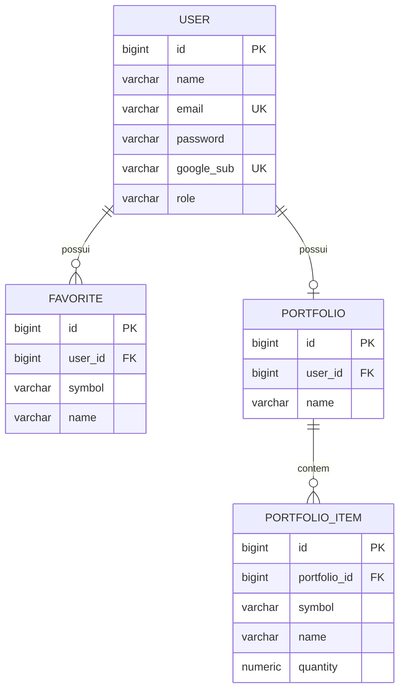

# Relatório-base — InvestView-API

> Documento gerado a partir da leitura direta do código-fonte, configurações, Docker e histórico Git em **2026-11-12**.
> O working tree local contém alterações ainda não commitadas (login local/JWT e ajustes relacionados); o último commit é `734a4e0`.
> Valores de `.env`, senhas, tokens, client IDs e URLs de banco **não foram reproduzidos**. Apenas nomes de variáveis são documentados.

## 1. Visão geral

| Item | Informação |
| --- | --- |
| Nome | InvestView-API |
| Tipo | API REST de investimentos |
| Objetivo | Gerenciar usuários, ativos favoritos, carteira simulada e um grafo global de ativos derivado da coocorrência de favoritos |
| Problema que resolve | Centraliza o cadastro de usuários e seus ativos de interesse, permite simular uma carteira com quantidades e oferece uma visão agregada das relações entre ativos favoritados pelos usuários |
| Repositório | https://github.com/jcdev01/Investview-API.git |
| Branch principal | `main` |
| Pacote base | `jairo.investviewapi` |
| Porta padrão | `8080` |
| Estado | Em desenvolvimento ativo; funcionalidades principais implementadas e 36 testes automatizados passando |

O sistema não consulta cotações nem APIs externas de mercado. O backend armazena a identidade do ativo (`symbol`), não preços. A carteira é uma simulação de quantidades, sem cálculo de valor financeiro.

## 2. Stack e versões

### Linguagem, framework e build

| Item | Versão / detalhe |
| --- | --- |
| Linguagem | Java 25 (`java.version` no `pom.xml`) |
| Framework | Spring Boot 4.1.2 (`spring-boot-starter-parent`) |
| Build tool | Maven, via Maven Wrapper (`mvnw`, `mvnw.cmd`, `.mvn`) |
| Build da imagem | `maven:3.9-eclipse-temurin-25` |
| Runtime da imagem | `eclipse-temurin:25-jre-alpine` |

### Bibliotecas principais (dependências diretas e versões resolvidas)

| Biblioteca | Versão | Uso |
| --- | --- | --- |
| Spring Web MVC (`spring-boot-starter-webmvc`) | 4.1.2 (gerenciada) | Controllers REST |
| Spring Data JPA | 4.1.2 (gerenciada) | Persistência |
| Hibernate ORM | 7.4.13.Final (resolvida) | Implementação JPA |
| Spring Data Redis | 4.1.2 (gerenciada) | Dependência presente, sem uso no código |
| Spring Security | 7.1.2 (resolvida) | Autenticação e autorização |
| Spring Security OAuth2 Resource Server | gerenciada pelo Boot 4.1.2 | Validação de JWT Bearer |
| Bean Validation (`spring-boot-starter-validation`) | gerenciada | Validação de DTOs |
| SpringDoc OpenAPI Web MVC UI | 3.2.0 | Swagger UI e OpenAPI JSON |
| Lombok | 1.18.48 | Getters, setters, builders e construtores |
| PostgreSQL JDBC Driver | 42.7.14 | Banco do profile `prod` |
| H2 Database | 2.4.240 | Banco em memória do profile `test` |
| Spring Boot H2 Console | gerenciada | Console H2 no profile `test` |
| Nimbus JOSE + JWT | 10.9.1 | Assinatura/validação de JWT local e parsing do `iss` |
| Jackson | 3.1.7 (`tools.jackson`) e 2.21.7 (`com.fasterxml`, transitiva) | JSON |
| JUnit 5 + Spring Boot Test | gerenciadas | Testes automatizados |

### Bancos, cache e containerização

| Item | Detalhe |
| --- | --- |
| Banco de teste/dev | H2 em memória (`test`) |
| Banco de produção | PostgreSQL (`prod`) |
| Cache | Redis 7 provisionado via Docker Compose, mas **não utilizado no código** |
| Containerização | `Dockerfile` multi-stage e `docker-compose.yml` com PostgreSQL 17 e Redis 7 |
| Migrações | Não há Flyway nem Liquibase; o schema é gerado por `spring.jpa.hibernate.ddl-auto=update` |
| Observabilidade | Não há Actuator nem Micrometer no `pom.xml` |

## 3. Arquitetura e estrutura de pastas

### Pacotes e responsabilidades

```text
src/main/java/jairo/investviewapi/
├── InvestviewApiApplication.java          -> classe de bootstrap do Spring Boot
├── config/
│   ├── SecurityConfig.java                -> beans comuns: PasswordEncoder, JwtEncoder, JwtDecoder roteador, CORS e AuthenticationManager
│   ├── DevSecurityConfig.java             -> security chain de !prod (form login, HTTP Basic, JWT, H2 e Swagger)
│   └── ProdSecurityConfig.java            -> security chain de prod (stateless, somente JWT)
├── controller/
│   ├── AuthController.java                -> /auth/login, /auth/forgot-password e /auth/me
│   ├── UserController.java                -> CRUD administrativo de /users
│   ├── FavoriteController.java            -> favoritos em /users/{userId}/favorites
│   ├── PortfolioController.java           -> carteira em /users/{userId}/portfolio
│   └── GraphController.java               -> grafo global em /graph
├── dto/
│   ├── LoginRequest.java                  -> entrada do login local
│   ├── PasswordResetRequest.java          -> entrada do reset de senha
│   ├── TokenResponse.java                 -> saída do login local (token, tokenType, expiresIn)
│   ├── UserCreateRequest.java             -> entrada de criação de usuário
│   ├── UserUpdateRequest.java             -> entrada de atualização de usuário
│   ├── UserResponse.java                  -> saída de usuário sem senha
│   ├── FavoriteRequest.java               -> entrada de favorito
│   ├── FavoriteResponse.java              -> saída de favorito
│   ├── PortfolioRenameRequest.java        -> renomear carteira
│   ├── PortfolioItemRequest.java          -> adicionar cota
│   ├── PortfolioItemUpdateRequest.java    -> atualizar cota
│   ├── PortfolioResponse.java             -> carteira com itens
│   ├── PortfolioItemResponse.java         -> cota da carteira
│   ├── GraphNode.java                     -> nó do grafo
│   ├── GraphEdge.java                     -> aresta com peso
│   ├── GraphResponse.java                 -> nós + arestas
│   ├── NeighborResponse.java              -> vizinho com peso
│   └── PathResponse.java                  -> resultado do caminho mínimo
├── entity/
│   ├── User.java                          -> usuário, papel e favoritos
│   ├── Role.java                          -> enum USER/ADMIN
│   ├── Favorite.java                      -> ativo favorito do usuário
│   ├── Portfolio.java                     -> carteira 1:1 com usuário
│   └── PortfolioItem.java                 -> cota da carteira
├── exception/
│   ├── ResourceNotFoundException.java     -> 404
│   ├── ConflictException.java             -> 409
│   ├── ErrorResponse.java                 -> contrato padrão de erro
│   └── GlobalExceptionHandler.java        -> mapeamento global de exceções para HTTP
├── graph/
│   ├── Graph.java                         -> interface do grafo
│   └── AdjacencyListGraph.java            -> implementação com lista de adjacência, BFS e componentes
├── repository/
│   ├── UserRepository.java                -> JpaRepository<User, Long>
│   ├── FavoriteRepository.java            -> JpaRepository<Favorite, Long> + projeção para o grafo
│   ├── FavoriteView.java                  -> projeção (userId, symbol, name)
│   ├── PortfolioRepository.java           -> JpaRepository<Portfolio, Long>
│   └── PortfolioItemRepository.java       -> JpaRepository<PortfolioItem, Long>
├── security/
│   ├── GoogleUserSyncFilter.java          -> provisionamento JIT e injeção de ROLE no SecurityContext
│   ├── CurrentUserProvider.java           -> resolução do usuário autenticado e proteção contra IDOR
│   └── UserDetailsServiceImpl.java        -> carrega usuário por e-mail para o login local
└── service/
    ├── UserService.java                   -> CRUD de usuário, hash de senha e reset
    ├── GoogleUserService.java             -> provisionamento/vinculação de usuário Google
    ├── TokenService.java                  -> emissão do JWT local
    ├── FavoriteService.java               -> regras de favoritos
    ├── PortfolioService.java              -> regras da carteira
    └── GraphService.java                  -> montagem e consultas do grafo
```

### Testes

```text
src/test/java/jairo/investviewapi/
├── InvestviewApiApplicationTests.java     -> carregamento do contexto
├── controller/
│   ├── AuthControllerTest.java            -> /auth/me com JWT Google
│   ├── LocalLoginTest.java                -> login local + uso do JWT
│   ├── OwnerAuthorizationTest.java        -> RBAC e IDOR
│   └── PortfolioControllerTest.java       -> CRUD da carteira
├── graph/
│   └── GraphControllerTest.java           -> grafo, vizinhos, BFS e componentes
└── service/
    └── GoogleUserServiceConcurrencyTest.java -> provisionamento concorrente
```

### Fluxo de uma requisição

1. A requisição passa pelo `CorsFilter`/configuração de CORS e pela `SecurityFilterChain` do profile ativo.
2. Em rotas com `Authorization: Bearer`, o `BearerTokenAuthenticationFilter` aciona o `JwtDecoder`.
3. O `JwtDecoder` lê o `iss` do token: se for o issuer local, usa o decoder HMAC local; caso contrário, usa o decoder do Google.
4. O `GoogleUserSyncFilter` roda depois do filtro Bearer. Para JWT com `email` e `email_verified=true`, ele provisiona o usuário no banco, grava o atributo `currentUser` na requisição e adiciona a autoridade `ROLE_<papel>` ao `SecurityContext`.
5. As regras de URL da chain e/ou `@PreAuthorize` autorizam a rota.
6. O controller chama `CurrentUserProvider` quando precisa validar dono/admin e delega ao service.
7. O service aplica regras de negócio e usa o repository Spring Data JPA.
8. O repository acessa H2 (profile `test`) ou PostgreSQL (profile `prod`).
9. O retorno é convertido para DTO `record` e serializado como JSON.
10. Exceções de controller/service passam pelo `GlobalExceptionHandler`, que devolve `ErrorResponse` para a maioria dos casos.

No login local (`POST /auth/login`), o fluxo é: rota pública -> `AuthenticationManager` (`ProviderManager` com `DaoAuthenticationProvider` por `UserDetailsService`) -> `UserDetailsServiceImpl` -> `TokenService` -> `JwtEncoder` HMAC -> `TokenResponse`.

## 4. Endpoints

### Autenticação (`/auth`)

| Método | Rota | Descrição | Quem pode acessar | Sucesso | Erros possíveis |
| --- | --- | --- | --- | --- | --- |
| POST | `/auth/login` | Autentica e-mail/senha e emite JWT local | Público | 200 `TokenResponse` | 400 validação; 401 credenciais inválidas; 500 genérico |
| POST | `/auth/forgot-password` | Redefine a senha informando e-mail e nova senha | Público | 204 sem corpo | 400 validação; 404 e-mail não encontrado; 500 genérico |
| GET | `/auth/me` | Provisiona/retorna o usuário autenticado | Autenticado com JWT | 200 `UserResponse` | 400 token sem e-mail verificado; 401 token ausente/inválido |

Observações:
- O login local só funciona para usuário existente no banco com senha cadastrada. O admin em memória do profile `!prod` autentica, mas não recebe token porque o `TokenService` exige usuário no banco; nesse caso retorna 401.
- O JWT local tem `iss` próprio, `email_verified=true` e TTL configurável; ele é aceito como Bearer nas rotas protegidas.
- `/auth/forgot-password` é público e troca a senha apenas com o e-mail; é uma limitação de segurança conhecida.

### Usuários (`/users`) — somente ADMIN

| Método | Rota | Descrição | Quem pode acessar | Sucesso | Erros possíveis |
| --- | --- | --- | --- | --- | --- |
| POST | `/users` | Cria usuário | ADMIN | 201 + `Location` + `UserResponse` | 400; 401; 403; 409 e-mail duplicado |
| GET | `/users` | Lista todos os usuários | ADMIN | 200 lista de `UserResponse` | 401; 403 |
| GET | `/users/{id}` | Busca usuário por ID | ADMIN | 200 `UserResponse` | 401; 403; 404 |
| PUT | `/users/{id}` | Atualiza nome, e-mail e/ou senha | ADMIN | 200 `UserResponse` | 400; 401; 403; 404; 409 e-mail duplicado |
| DELETE | `/users/{id}` | Remove usuário | ADMIN | 204 sem corpo | 401; 403; 404; 409/500 possível se houver violação de FK |

Observações:
- O controller inteiro tem `@PreAuthorize("hasRole('ADMIN')")`; as chains também restringem `/users/**` a `ADMIN`.
- `UserCreateRequest` não possui campo `role`; todo usuário criado pela API nasce `USER`.
- Não há endpoint para alterar papel, ativar/desativar conta ou listar com paginação.

### Favoritos (`/users/{userId}/favorites`) — dono ou ADMIN

| Método | Rota | Descrição | Quem pode acessar | Sucesso | Erros possíveis |
| --- | --- | --- | --- | --- | --- |
| POST | `/users/{userId}/favorites` | Adiciona ativo aos favoritos | Dono ou ADMIN | 201 + `Location` + `FavoriteResponse` | 400; 401; 403; 404; 409 duplicidade |
| GET | `/users/{userId}/favorites` | Lista favoritos do usuário | Dono ou ADMIN | 200 lista de `FavoriteResponse` | 401; 403; 404 |
| DELETE | `/users/{userId}/favorites/{favoriteId}` | Remove favorito | Dono ou ADMIN | 204 sem corpo | 401; 403; 404 |

### Carteira (`/users/{userId}/portfolio`) — dono ou ADMIN

| Método | Rota | Descrição | Quem pode acessar | Sucesso | Erros possíveis |
| --- | --- | --- | --- | --- | --- |
| GET | `/users/{userId}/portfolio` | Retorna a carteira; cria uma vazia no primeiro acesso | Dono ou ADMIN | 200 `PortfolioResponse` | 401; 403; 404 usuário inexistente |
| PUT | `/users/{userId}/portfolio` | Renomeia a carteira | Dono ou ADMIN | 200 `PortfolioResponse` | 400; 401; 403; 404 |
| GET | `/users/{userId}/portfolio/items` | Lista as cotas | Dono ou ADMIN | 200 lista de `PortfolioItemResponse` | 401; 403; 404 |
| POST | `/users/{userId}/portfolio/items` | Adiciona cota; se o ativo já existir, soma a quantidade | Dono ou ADMIN | 201 + `Location` + `PortfolioItemResponse` | 400; 401; 403; 404; 409 possível em corrida/violação de unique |
| PUT | `/users/{userId}/portfolio/items/{itemId}` | Define quantidade absoluta e/ou nome da cota | Dono ou ADMIN | 200 `PortfolioItemResponse` | 400; 401; 403; 404 |
| DELETE | `/users/{userId}/portfolio/items/{itemId}` | Remove cota | Dono ou ADMIN | 204 sem corpo | 401; 403; 404 |

### Grafo (`/graph`) — autenticado

| Método | Rota | Descrição | Quem pode acessar | Sucesso | Erros possíveis |
| --- | --- | --- | --- | --- | --- |
| GET | `/graph` | Retorna o grafo completo (nós e arestas com pesos) | Autenticado | 200 `GraphResponse` | 401 |
| GET | `/graph/assets/{symbol}/neighbors` | Retorna vizinhos do ativo, ordenados por peso decrescente | Autenticado | 200 lista de `NeighborResponse` | 401; 404 ativo fora do grafo |
| GET | `/graph/path?from=...&to=...` | Menor caminho entre dois ativos via BFS | Autenticado | 200 `PathResponse` | 400 símbolo em branco; 401; 404 ativo fora do grafo |
| GET | `/graph/components` | Retorna componentes conexos | Autenticado | 200 lista de listas de símbolos | 401 |

Observações:
- O grafo é global e agregado: não expõe quais usuários favoritaram cada ativo.
- Caminho inexistente entre ativos existentes retorna 200 com `found=false`, `path=[]` e `length=0`.
- As rotas de grafo não chamam `CurrentUserProvider`; elas dependem apenas de autenticação válida.

### Outros recursos HTTP

| Recurso | Rota | Acesso | Observação |
| --- | --- | --- | --- |
| Swagger UI | `/swagger-ui.html`, `/swagger-ui/**` | Público em todos os profiles | Documentação interativa |
| OpenAPI JSON | `/v3/api-docs/**` | Público em todos os profiles | Especificação OpenAPI |
| Console H2 | `/h2-console/**` | Público em `!prod` (dev/test); desabilitado em `prod` | Ferramenta de inspeção do H2; não é API de negócio |
| Form login do Spring | `/login` (GET/POST) | Profile `!prod` | Login de desenvolvimento do admin em memória |
| HTTP Basic | Qualquer rota autenticada | Profile `!prod` | Também aceito no desenvolvimento; não substitui JWT nas rotas que exigem `CurrentUserProvider` |
| Actuator | — | — | [NÃO IMPLEMENTADO] |
| Relatórios/estatísticas | — | — | [NÃO IMPLEMENTADO] |

Erros adicionais tratados pelo `ResponseEntityExceptionHandler`: 405 método não suportado, 406 mídia não aceitável, 415 mídia não suportada, além de 400 para parâmetros/JSON inválidos e 500 genérico. Respostas de 401/403 geradas diretamente pela filter chain podem não seguir o contrato `ErrorResponse`.

## 5. Modelo de dados

### Entidades e tabelas

| Entidade | Tabela | Campos principais | Constraints |
| --- | --- | --- | --- |
| `User` | `tb_users` | `id` Long; `name` String(120); `email` String(160); `password` String; `googleSub` String(255); `role` enum `USER`/`ADMIN`; `favorites` lista | PK `id` IDENTITY; `name` NOT NULL; `email` NOT NULL e UNIQUE; `google_sub` UNIQUE e nullable; `role` NOT NULL |
| `Favorite` | `tb_favorites` | `id` Long; `user` ManyToOne; `symbol` String(20); `name` String(120) | PK `id`; FK `user_id` NOT NULL; `symbol` NOT NULL; UNIQUE `(user_id, symbol)` |
| `Portfolio` | `tb_portfolios` | `id` Long; `user` OneToOne; `name` String(120); `items` lista | PK `id`; FK `user_id` NOT NULL; `name` NOT NULL; unicidade de `user_id` é implícita do `@OneToOne` (não há `@UniqueConstraint` explícita no código) [NÃO CONFIRMADO no DDL exato] |
| `PortfolioItem` | `tb_portfolio_items` | `id` Long; `portfolio` ManyToOne; `symbol` String(20); `name` String(120); `quantity` BigDecimal(19,8) | PK `id`; FK `portfolio_id` NOT NULL; `symbol` NOT NULL; `quantity` NOT NULL; UNIQUE `(portfolio_id, symbol)` |

### Enums

| Enum | Valores | Uso |
| --- | --- | --- |
| `Role` | `USER`, `ADMIN` | Papel do usuário; persistido como string |

### Relacionamentos

- `User` 1:N `Favorite` (`mappedBy = "user"`, `cascade = ALL`, `orphanRemoval = true`).
- `User` 1:1 `Portfolio` (o lado `User` não mapeia a carteira; o `Portfolio` possui a FK `user_id`).
- `Portfolio` 1:N `PortfolioItem` (`mappedBy = "portfolio"`, `cascade = ALL`, `orphanRemoval = true`).
- `Portfolio.user` e `PortfolioItem.portfolio` usam `@OnDelete(action = CASCADE)` para deleção no banco.
- `Favorite.user` é `ManyToOne` LAZY; não possui `@OnDelete` explícito, mas os favoritos são removidos pelo cascade JPA do `User`.

### Diagrama Mermaid



### Observações de persistência

- Não há campos de auditoria (`createdAt`, `updatedAt`), soft delete, `@Version` para lock otimista nem flag `enabled`.
- `password` é nullable para permitir usuários criados apenas por login Google; usuários com senha nula não conseguem login local.
- O schema é criado/atualizado pelo Hibernate (`ddl-auto=update`) nos profiles `test` e `prod`; não há migrações versionadas.
- `spring.jpa.open-in-view=false` está configurado.
- H2 é usado no profile `test`; PostgreSQL no profile `prod`.

## 6. Regras de negócio e algoritmos

### Normalização de símbolos

- Em favoritos e carteira, o `symbol` é normalizado com `trim().toUpperCase()`.
- Em favoritos, `name` opcional é aparado; se ficar em branco, vira `null`.
- Na carteira, `name` opcional é aparado; se ficar em branco, vira `null`.
- No grafo, `symbol` também é normalizado com `trim().toUpperCase()`; entrada nula ou em branco lança `IllegalArgumentException`, que retorna 400.
- Não há validação de formato/ticker além de `@NotBlank` e `@Size(max = 20)` nos DTOs de favorito e carteira.

### Favoritos

- Cada usuário pode ter no máximo um favorito por `symbol` (unique `(user_id, symbol)`).
- A adição verifica duplicidade e lança `ConflictException` (409); a constraint do banco também protege contra corrida, e a violação é mapeada para 409.
- A remoção busca o favorito por `id` e `user_id`; se não existir, retorna 404.
- A listagem retorna todos os favoritos do usuário, sem paginação.

### Carteira

- A carteira é criada sob demanda no primeiro acesso, com nome padrão `"Minha carteira"`.
- `POST /items` faz upsert por `symbol`:
  - se a cota já existir, soma a quantidade informada;
  - se não existir, cria uma nova cota.
- `PUT /items/{itemId}` define a quantidade absoluta e, opcionalmente, atualiza o nome.
- `quantity` deve ser positiva, com até 11 dígitos inteiros e 8 decimais (`BigDecimal`, precisão 19, escala 8).
- A listagem de cotas é ordenada por `id` crescente.
- A remoção busca a cota por `id` e pelo `user_id` da carteira; se não existir, retorna 404.
- Não há cálculo de preço, valor de mercado, rentabilidade ou cotação.

### Grafo de ativos

O grafo é derivado de **todos** os favoritos de **todos** os usuários:

- **Nó:** cada `symbol` normalizado é um nó; `id` e `symbol` do nó são o próprio símbolo; `name` é o primeiro nome não nulo encontrado para aquele símbolo.
- **Aresta:** para cada usuário, todos os pares distintos de ativos favoritados por ele geram uma aresta não direcionada. A chave da aresta é normalizada em ordem lexicográfica (`EdgeKey`), então `source`/`target` retornados ficam em ordem alfabética.
- **Peso:** número de usuários distintos que favoritaram o par. A unique `(user_id, symbol)` garante que cada usuário contribua no máximo uma vez por par.
- **Montagem:** `GraphService.buildGraph()` usa a projeção `FavoriteRepository.findAllWithUserId()` (sem N+1), agrupa por usuário em `LinkedHashMap` e combina os pares.
- **Persistência:** o grafo **não é persistido**; é recalculado em memória a cada requisição.
- **Cache:** não há cache; Redis não é usado para o grafo.

### BFS e caminho mínimo

- `AdjacencyListGraph.shortestPath(from, to)` usa BFS com fila `ArrayDeque` e mapa de predecessores.
- O BFS ignora os pesos; o caminho é mínimo em número de arestas.
- Se `from == to`, retorna uma lista com o próprio nó.
- Se algum nó não existir, o service lança 404 antes de chamar o BFS.
- Se não houver caminho, retorna `Optional.empty()` e o endpoint responde 200 com `found=false`, `path=[]`, `length=0`.
- `length` é `path.size() - 1`.

### Vizinhos e componentes

- Vizinhos são ordenados por peso decrescente e, em empate, por `id` crescente.
- Componentes conexos são calculados por DFS iterativo com pilha.
- Cada componente é ordenado alfabeticamente; a lista de componentes é ordenada por tamanho decrescente e, em empate, pelo primeiro `id` do componente.
- Componentes de um único nó são retornados normalmente.

### Provisionamento JIT do usuário Google

- O `GoogleUserSyncFilter` roda após o `BearerTokenAuthenticationFilter`.
- Ele só provisiona quando o token é `JwtAuthenticationToken`, possui `email` e o claim `email_verified` é exatamente booleano `true`.
- `GoogleUserService.provision(email, name, googleSub)`:
  - calcula o papel alvo: `ADMIN` se o e-mail estiver em `APP_SECURITY_ADMIN_EMAILS` (comparação em minúsculas), senão `USER`;
  - busca por e-mail exato; se não existir, cria com `name` ou o próprio e-mail como fallback;
  - se o usuário existente for promovido a `ADMIN`, atualiza o papel; nunca rebaixa `ADMIN` para `USER`;
  - grava `google_sub` apenas se ainda for nulo;
  - salva dentro de `TransactionTemplate`;
  - se ocorrer `DataIntegrityViolationException` (corrida de INSERT), tenta mais uma vez em nova transação.
- Após provisionar, o filtro coloca o `User` no atributo `currentUser` da requisição e adiciona `ROLE_<papel>` às autoridades.
- O `/auth/me` chama `provision` novamente; hoje há provisionamento duplicado por requisição nessa rota.

### Login local

- `POST /auth/login` valida e-mail/senha via `AuthenticationManager`.
- O `AuthenticationManager` é um `ProviderManager` com um `DaoAuthenticationProvider` por `UserDetailsService` disponível.
- `UserDetailsServiceImpl` busca o usuário por e-mail exato e monta um `org.springframework.security.core.userdetails.User` com a role do banco.
- `TokenService.generate(email)` exige usuário no banco, monta claims `iss`, `iat`, `exp`, `email`, `email_verified=true`, `name` e `role`, e assina com HMAC-SHA256.
- O token local não possui `sub`; isso evita que o `GoogleUserSyncFilter` grave `googleSub` a partir de um login local.
- O claim `role` do token local não é usado diretamente para autorização; o filtro recarrega o usuário do banco e injeta a role real.
- Não há refresh token, revogação ou rotação de segredo.

### Reset de senha

- `POST /auth/forgot-password` busca o usuário por e-mail exato.
- Se não existir, lança `ResourceNotFoundException` (404), revelando a existência da conta.
- Se existir, codifica a nova senha com BCrypt e salva; retorna 204.
- Não há token de reset, envio de e-mail, expiração ou verificação de identidade.

## 7. Segurança

### Autenticação

| Mecanismo | Detalhe |
| --- | --- |
| Google OAuth2 | Resource Server com JWT Bearer; o front obtém o ID token do Google e envia `Authorization: Bearer <token>` |
| Validação do token Google | Issuer configurado, audience igual a `APP_OAUTH_GOOGLE_CLIENT_ID`, timestamps padrão e JWK Set remoto |
| JWT local | HMAC-SHA256 com `app.jwt.secret`, issuer `app.jwt.issuer`, TTL `app.jwt.ttl` |
| Roteamento de decoder | O `JwtDecoder` lê o `iss` com `SignedJWT.parse`; se for o issuer local, usa o decoder HMAC; caso contrário, usa o decoder Google |
| Segredo local | Deve ter pelo menos 32 bytes; caso contrário, o bean lança `IllegalStateException` |
| Audience | Se `APP_OAUTH_GOOGLE_CLIENT_ID` estiver vazio, a validação de audience falha para qualquer token Google |
| Login local | `AuthenticationManager` com `DaoAuthenticationProvider` e BCrypt |
| Sessão | `prod` é stateless; `!prod` permite form login/HTTP Basic e pode criar sessão para esses fluxos |

### Autorização e RBAC

- `@EnableMethodSecurity` está habilitado.
- `UserController` tem `@PreAuthorize("hasRole('ADMIN')")` no nível da classe.
- As chains restringem:
  - `/users/**` a `ADMIN`;
  - `/users/*/favorites/**` e `/users/*/portfolio/**` a `USER` ou `ADMIN`;
  - `/graph/**` e `/auth/me` a qualquer autenticado;
  - `/auth/login`, `/auth/forgot-password`, Swagger e H2 console (em `!prod`) como públicos.
- O papel efetivo vem do banco: o `GoogleUserSyncFilter` injeta `ROLE_<role>` após provisionar.
- `APP_SECURITY_ADMIN_EMAILS` define e-mails que viram `ADMIN` no provisionamento Google.
- O admin em memória do profile `!prod` recebe `ADMIN` e `USER`.
- Não há endpoint para promover/rebaixar papéis; usuários criados via API são sempre `USER`.

### Proteção contra IDOR

- `CurrentUserProvider` só aceita `JwtAuthenticationToken` com `email` e `email_verified=true`.
- Ele busca o usuário por e-mail e expõe `requireOwner`, `requireOwnerOrAdmin`, `requireAdmin` e `isOwner`.
- `FavoriteController` e `PortfolioController` chamam `requireOwnerOrAdmin(userId)` antes do service.
- Dono acessa seus próprios dados; `ADMIN` pode acessar dados de qualquer usuário.
- Violação lança `AccessDeniedException`, mapeada para 403.
- O grafo é global e não expõe usuários; não há IDOR de usuário nas rotas de grafo.

### CORS, CSRF e sessão

- CSRF está desabilitado nas duas chains.
- CORS usa `APP_CORS_ALLOWED_ORIGINS`; se a lista estiver vazia, nenhuma origem cruzada é permitida.
- Métodos permitidos: `GET`, `POST`, `PUT`, `PATCH`, `DELETE`, `OPTIONS`; headers `*`; `allowCredentials=true`.
- O console H2 tem configuração CORS separada e permissiva (`allowedOriginPatterns=*`, sem credenciais).
- `prod` usa `SessionCreationPolicy.STATELESS`.
- `!prod` habilita `formLogin` e `httpBasic` e permite frames same-origin para o H2.

### Tratamento global de exceções

`GlobalExceptionHandler` estende `ResponseEntityExceptionHandler` e padroniza:

| Exceção | HTTP |
| --- | --- |
| `ResourceNotFoundException` | 404 |
| `ConflictException` | 409 |
| `AccessDeniedException` | 403 |
| `AuthenticationException` | 401 |
| `DataIntegrityViolationException` | 409 |
| `ConstraintViolationException` | 400 com lista de campos |
| `IllegalArgumentException` | 400 |
| `MethodArgumentNotValidException` | 400 com erros por campo |
| `HttpMessageNotReadableException` | 400 corpo inválido/malformado |
| `NoResourceFoundException` | 404 |
| `Exception` | 500 com mensagem genérica |

O corpo é `ErrorResponse(timestamp, status, error, message, path, errors[])`.

Limitações:
- `handleGeneric` não registra a exceção em log.
- 401/403 gerados pela filter chain podem não usar `ErrorResponse`.
- O 500 genérico não expõe detalhes, o que é bom para segurança, mas dificulta diagnóstico.

### Segredos e configuração

- Segredos são esperados em variáveis de ambiente e/ou no arquivo `.env` da raiz.
- `.env` está no `.gitignore` e no `.dockerignore`.
- Não existe `.env.example` no repositório atualmente.
- `application.properties` importa `.env` opcionalmente com `spring.config.import=optional:file:.env[.properties]`.
- Não há valores reais de produção no código; há valores default apenas de desenvolvimento/teste para o segredo JWT (não reproduzidos aqui).
- `APP_JWT_SECRET` é obrigatório no profile `prod` (sem default em `application-prod.properties`).

### Diferenças entre profiles

| Aspecto | `test` / `!prod` | `prod` |
| --- | --- | --- |
| Banco | H2 em memória | PostgreSQL via `DB_*` |
| H2 console | Habilitado e acessível remotamente | Desabilitado |
| Chain | `DevSecurityConfig` | `ProdSecurityConfig` |
| Form login / HTTP Basic | Habilitados | Desabilitados |
| Admin em memória | Sim | Não |
| Sessão | Pode criar sessão para form login/Basic | Stateless |
| Swagger | Público | Público |
| JWT local | Habilitado | Habilitado |
| Segredo JWT | Default de dev/test | `APP_JWT_SECRET` obrigatório |

### Pontos fracos e riscos identificados

- `/auth/forgot-password` é público e permite trocar a senha apenas com o e-mail; também revela se o e-mail existe (404 vs 204).
- Não há refresh token, revogação, rotação de segredo nem lista de tokens inválidos.
- Swagger é público também em `prod`.
- O `Dockerfile` define `SPRING_PROFILES_ACTIVE=test`, expondo H2 em memória e H2 console se a imagem for usada como está.
- O profile `test` habilita H2 console com acesso remoto (`web-allow-others=true`).
- O admin em memória de desenvolvimento continua existindo em `!prod`.
- Há aviso residual do Spring Security sobre dois `UserDetailsService` beans.
- `/auth/me` provisiona o usuário duas vezes por requisição.
- O atributo `currentUser` é gravado no request, mas não é reutilizado.
- E-mails não são normalizados (trim/lowercase) em criação, login, reset ou provisionamento; isso pode gerar duplicidade ou falha por caixa.
- `APP_CORS_ALLOWED_ORIGINS` vazio bloqueia qualquer origem cruzada.
- Rotas que só exigem `authenticated()` (como `/graph`) não chamam `CurrentUserProvider`; um JWT válido sem e-mail verificado pode acessá-las, pois o filtro apenas deixa de provisionar, não bloqueia.
- Não há rate limiting, bloqueio de conta, MFA, verificação de e-mail para login local nem política de senha além de `min = 6`.
- Não há auditoria, logs estruturados, métricas ou tracing.
- Não há HTTPS/TLS configurado na aplicação; a terminação TLS, se existir, está fora do código [NÃO CONFIRMADO].
- Não há paginação em listagens.
- Há risco de corrida em `getOrCreatePortfolio` e `addItem` (check-then-act).
- A exclusão de usuário depende do cascade do banco para `Portfolio`; o `User` não mapeia a carteira.
- O segredo JWT de desenvolvimento tem default no `application.properties`; é preciso garantir que `APP_JWT_SECRET` seja sempre definido em produção.
- As propriedades de Redis são referenciadas sem default, embora o Redis não seja usado; o efeito exato da ausência dessas variáveis no startup é [NÃO CONFIRMADO].
- O claim `role` do JWT local não é usado para autorização; a role vem do banco, o que é mais seguro, mas significa que mudanças de papel só valem após nova leitura do usuário.
- Usuário criado apenas por Google (`password` nulo) não consegue login local até que uma senha seja definida.

## 8. Configuração e variáveis de ambiente

### Profiles

| Profile | Como é ativado | Uso |
| --- | --- | --- |
| `test` | `SPRING_PROFILES_ACTIVE=test` (ambiente/.env) | Testes automatizados, H2 em memória, H2 console, admin em memória |
| `prod` | `SPRING_PROFILES_ACTIVE=prod` | PostgreSQL, segurança stateless, sem H2 console |
| Nenhum/default | `spring.profiles.active=${SPRING_PROFILES_ACTIVE}` sem valor default | A aplicação não define profile padrão; sem a variável, o profile fica vazio e o comportamento depende dos defaults do Spring [NÃO CONFIRMADO] |

O `application.properties` importa opcionalmente o arquivo `.env` da raiz:

```properties
spring.config.import=optional:file:.env[.properties]
```

### Arquivos de configuração

| Arquivo | Conteúdo principal |
| --- | --- |
| `src/main/resources/application.properties` | Nome da aplicação, import do `.env`, porta, JPA, JWT, OAuth, CORS, Redis, Swagger |
| `src/main/resources/application-test.properties` | H2 em memória, console H2, DDL update, JWT de teste, admin em memória |
| `src/main/resources/application-prod.properties` | PostgreSQL via `DB_*`, `APP_JWT_SECRET` obrigatório, DDL update, H2 console desabilitado |

### Variáveis de ambiente e propriedades

| Variável | Propriedade | Obrigatória? | Default no código | Finalidade |
| --- | --- | --- | --- | --- |
| `SPRING_PROFILES_ACTIVE` | `spring.profiles.active` | Não | Nenhum | Seleciona `test`, `prod` ou outro profile |
| `SERVER_PORT` (opcional) | `server.port` | Não | `8080` | Porta HTTP |
| `DB_URL` | `spring.datasource.url` | Sim em `prod` | Sem default em `prod` | JDBC URL do PostgreSQL |
| `DB_USERNAME` | `spring.datasource.username` | Sim em `prod` | Sem default em `prod` | Usuário do banco |
| `DB_PASSWORD` | `spring.datasource.password` | Sim em `prod` | Sem default em `prod` | Senha do banco |
| `APP_JWT_SECRET` | `app.jwt.secret` | Sim em `prod` | Default de dev/test presente (não reproduzido) | Segredo HMAC do JWT local; mínimo de 32 bytes |
| `APP_JWT_ISSUER` (opcional) | `app.jwt.issuer` | Não | `investview-api` | Issuer do JWT local e critério de roteamento do decoder |
| `APP_JWT_TTL` (opcional) | `app.jwt.ttl` | Não | `PT1H` | TTL do JWT local |
| `APP_OAUTH_GOOGLE_CLIENT_ID` | `app.oauth.google.client-id` | Sim | Sem default | Audience esperada do ID token Google |
| `APP_OAUTH_GOOGLE_ISSUER` | `app.oauth.google.issuer` | Sim | Sem default | Issuer do Google usado na validação |
| `APP_OAUTH_GOOGLE_JWK_SET_URI` | `app.oauth.google.jwk-set-uri` | Sim | Sem default | URL do JWK Set do Google |
| `APP_SECURITY_USERNAME` | `app.security.username` | Sim em `!prod` | Sem default | Usuário do admin em memória de desenvolvimento |
| `APP_SECURITY_PASSWORD` | `app.security.password` | Sim em `!prod` | Sem default | Senha do admin em memória de desenvolvimento |
| `APP_CORS_ALLOWED_ORIGINS` | `app.cors.allowed-origins` | Não | Vazio | Lista de origens permitidas no CORS |
| `APP_SECURITY_ADMIN_EMAILS` | `app.security.admin-emails` | Não | Vazio | E-mails promovidos a `ADMIN` no provisionamento Google |
| `REDIS_HOST` | `spring.data.redis.host` | Sim para startup (resolvida sem default) | Sem default | Host do Redis (não usado no código) |
| `REDIS_PORT` | `spring.data.redis.port` | Sim para startup (resolvida sem default) | Sem default | Porta do Redis (não usado no código) |

Observações:
- Não há `.env.example` versionado; os nomes acima foram extraídos dos properties e do código.
- Valores reais de `.env` não foram reproduzidos neste relatório.
- O profile `test` contém default de JWT de teste; as credenciais do admin em memória vêm de `APP_SECURITY_USERNAME`/`APP_SECURITY_PASSWORD`. Os valores não são reproduzidos neste relatório.
- O profile `prod` não define default para `DB_URL`, `DB_USERNAME`, `DB_PASSWORD` nem `APP_JWT_SECRET`.
- `APP_OAUTH_GOOGLE_CLIENT_ID`, `APP_OAUTH_GOOGLE_ISSUER` e `APP_OAUTH_GOOGLE_JWK_SET_URI` são resolvidos sem default nos properties; a ausência deles pode impedir o startup mesmo quando o login Google não é usado.
- As propriedades de Redis não têm default; como o Redis não é usado, o impacto exato da ausência dessas variáveis no startup é [NÃO CONFIRMADO].
- A configuração de e-mail (`spring.mail.*`) não está presente; não há envio real de e-mail.

### Configurações relevantes

| Propriedade | Valor |
| --- | --- |
| `spring.jpa.hibernate.ddl-auto` | `update` em `test` e `prod` |
| `spring.jpa.open-in-view` | `false` |
| `spring.jpa.show-sql` | `false` (default) |
| `spring.h2.console.enabled` | `true` em `test`; `false` em `prod` |
| `spring.h2.console.settings.web-allow-others` | `true` em `test` |
| `springdoc.swagger-ui.path` | `/swagger-ui.html` |
| `springdoc.api-docs.path` | `/v3/api-docs` |
| `server.error.include-message` | Não configurado; o handler global controla o corpo de erro |

## 9. Infraestrutura, Docker e deploy

### Dockerfile

| Etapa | Detalhe |
| --- | --- |
| Build | `maven:3.9-eclipse-temurin-25`; copia `pom.xml`, baixa dependências, copia `src`, executa `mvn -B package -DskipTests` |
| Runtime | `eclipse-temurin:25-jre-alpine` |
| Usuário | Cria e usa usuário não-root `spring` |
| Artefato | Copia o JAR de `target/*.jar` para `app.jar` |
| Variável de ambiente | `ENV SPRING_PROFILES_ACTIVE=test` |
| Porta | `EXPOSE 8080` |
| Entrada | `sh -c "exec java $JAVA_OPTS -jar app.jar"` |
| Healthcheck | Não possui |
| Testes no build | Ignorados com `-DskipTests` |

O `ENV SPRING_PROFILES_ACTIVE=test` é um ponto de atenção: se a imagem for executada sem sobrescrever a variável, a aplicação sobe com H2 em memória e H2 console, não com PostgreSQL.

### docker-compose.yml

| Serviço | Imagem | Porta | Volumes | Healthcheck | Observação |
| --- | --- | --- | --- | --- | --- |
| `postgres` | `postgres:17-alpine` | `5432:5432` | volume nomeado de dados | `pg_isready` | Variáveis `POSTGRES_DB`, `POSTGRES_USER`, `POSTGRES_PASSWORD` vêm do `.env` |
| `redis` | `redis:7-alpine` | `6379:6379` | volume nomeado de dados | `redis-cli ping` | Provisionado, mas não usado pela aplicação |
| Aplicação | — | — | — | — | Não há serviço da API no Compose |

O Compose não sobe a API. Para rodar a aplicação em container, é necessário construir a imagem e passar as variáveis de ambiente corretas, sobrescrevendo o profile `test`.

### Deploy

| Item | Informação |
| --- | --- |
| Plataforma documentada | SnapDeploy |
| URL documentada | `https://investview-api-9abc6.containers.snapdeploy.app` |
| Estado atual da URL | [NÃO CONFIRMADO] |
| Profile esperado em produção | `prod` |
| TLS/HTTPS | Não configurado no código; terminação provavelmente na plataforma [NÃO CONFIRMADO] |
| CI/CD | Não há workflows no repositório; deploy parece manual [NÃO CONFIRMADO] |
| Infraestrutura como código | Não há Terraform, Kubernetes, Helm ou manifests |
| Banco gerenciado | [NÃO CONFIRMADO] |
| Backup/restore | [NÃO CONFIRMADO] |
| Escalabilidade horizontal | Não há configuração de sessão compartilhada; `prod` é stateless, mas o grafo é recalculado por instância |

A URL de deploy aparece em documentação antiga e não foi validada nesta análise. O relatório não afirma que o ambiente está no ar.

### Ambientes

| Ambiente | Banco | Como sobe | Observação |
| --- | --- | --- | --- |
| Local/dev | H2 (profile `test`) | `./mvnw spring-boot:run` com `SPRING_PROFILES_ACTIVE=test` | Admin em memória, H2 console, Swagger |
| Testes | H2 em memória | `./mvnw test` com `SPRING_PROFILES_ACTIVE=test` | Sem dependência de PostgreSQL |
| Produção | PostgreSQL | Imagem/Docker ou plataforma com `SPRING_PROFILES_ACTIVE=prod` | Requer `DB_*` e `APP_JWT_SECRET` |

## 10. Armazenamento, cache e processamento

### Armazenamento

- **Produção:** PostgreSQL, acessado via Spring Data JPA/Hibernate.
- **Teste:** H2 em memória, recriado a cada contexto de teste.
- **Arquivos:** não há upload, armazenamento local, S3 ou equivalente.
- **Schema:** gerado por `ddl-auto=update`; não há migrações versionadas.
- **Transações:** operações de escrita usam transações Spring; o provisionamento Google usa `TransactionTemplate` com retry para corrida de inserção.
- **Exclusão:** cascatas JPA e `@OnDelete` em `Portfolio`/`PortfolioItem`; não há soft delete.
- **Paginação:** não há paginação nas listagens.

### Cache

- Redis 7 é provisionado no Compose e configurado nos properties, mas **não há uso de Redis no código**.
- Não há `@Cacheable`, `RedisTemplate`, cache de grafo, cache de usuário ou cache de consultas.
- O grafo é recalculado a cada requisição.
- Não há invalidação de cache porque não há cache.

### Processamento

- O modelo é request-response síncrono; não há filas, jobs agendados, batch, workers ou mensageria.
- A montagem do grafo é feita em memória a partir de uma única consulta de favoritos.
- Complexidade aproximada:
  - montagem do grafo: proporcional à soma de pares de favoritos por usuário;
  - BFS: `O(V + E)`;
  - componentes: `O(V + E)`;
  - vizinhos: ordenação por peso.
- Não há processamento assíncrono nem paralelismo explícito.
- Não há limite de tamanho de grafo, paginação de nós/arestas ou timeout específico.

### Consistência e concorrência

- `Favorite` tem unique `(user_id, symbol)`; `PortfolioItem` tem unique `(portfolio_id, symbol)`.
- `Portfolio` é 1:1 com `User`; a unicidade de `user_id` é implícita do mapeamento, sem `@UniqueConstraint` explícita.
- `getOrCreatePortfolio` e `addItem` fazem check-then-act; sob concorrência podem ocorrer violações de unique ou duplicidade, tratadas parcialmente por `DataIntegrityViolationException` -> 409.
- Não há lock otimista (`@Version`) nem lock pessimista.
- O provisionamento Google tem retry de uma tentativa em caso de `DataIntegrityViolationException`.

## 11. Observabilidade

### O que existe

| Recurso | Estado |
| --- | --- |
| Swagger UI / OpenAPI | Implementado em `/swagger-ui.html` e `/v3/api-docs` |
| Logs | Logs padrão do Spring Boot no console; não há configuração customizada de formato/nível |
| Healthcheck da API | [NÃO IMPLEMENTADO] |
| Actuator | [NÃO IMPLEMENTADO] |
| Micrometer/Prometheus | [NÃO IMPLEMENTADO] |
| Métricas de negócio | [NÃO IMPLEMENTADO] |
| Tracing distribuído | [NÃO IMPLEMENTADO] |
| Correlation ID | [NÃO IMPLEMENTADO] |
| Auditoria de acesso/negócio | [NÃO IMPLEMENTADO] |
| Alertas | [NÃO IMPLEMENTADO] |
| Dashboard | [NÃO IMPLEMENTADO] |

### Logs

- Não há `logback-spring.xml` nem configuração de appenders.
- O `GlobalExceptionHandler` não registra a exceção genérica em log; o 500 é retornado sem rastro no código do handler.
- Não há logs estruturados em JSON.
- Não há mascaramento explícito de dados sensíveis em logs porque não há logs de negócio customizados.
- O Docker Compose possui healthcheck para PostgreSQL (`pg_isready`) e Redis (`redis-cli ping`); não há healthcheck da API.

### Diagnóstico

- O Swagger é a principal forma de inspeção dos endpoints.
- O H2 console existe apenas em `!prod`.
- Sem Actuator, não há endpoint de saúde, informação, métricas ou variáveis de ambiente.
- A ausência de logs de exceção e de correlation ID dificulta investigar erros 500 em produção.
- A documentação de deploy não descreve coleta de logs, monitoramento ou alarmes.

## 12. Testes

### Estratégia

- JUnit 5 + Spring Boot Test.
- Testes de integração com `@SpringBootTest` e `MockMvc`.
- Banco H2 em memória no profile `test`.
- Segurança real participa dos testes (JWT, filtros, RBAC), com tokens gerados nos testes.
- Não há testes unitários isolados de services com Mockito; a maioria exercita o contexto Spring.
- Não há `@ActiveProfiles` nas classes; os testes dependem de `SPRING_PROFILES_ACTIVE=test` no ambiente/.env.
- Não há Testcontainers, WireMock, testes de contrato ou testes de carga.

### Classes de teste

| Classe | Cobertura |
| --- | --- |
| `InvestviewApiApplicationTests` | Carregamento do contexto |
| `AuthControllerTest` | `/auth/me` com JWT Google |
| `LocalLoginTest` | Login local, emissão e uso do JWT |
| `OwnerAuthorizationTest` | RBAC e proteção contra IDOR |
| `PortfolioControllerTest` | CRUD da carteira |
| `GraphControllerTest` | Grafo, vizinhos, BFS e componentes |
| `GoogleUserServiceConcurrencyTest` | Provisionamento concorrente do usuário Google |

### Resultado da execução

Comando executado no Windows, a partir do WSL:

```text
cmd.exe /c "cd /d C:\Users\Jairo\IdeaProjects\Investview-API && mvnw.cmd test"
```

Resultado:

```text
Tests run: 36, Failures: 0, Errors: 0, Skipped: 0
BUILD SUCCESS
Total time: 11.941 s
Finished at: 2026-11-12T22:38:38-03:00
```

### Lacunas de teste

- Não há testes para `/auth/forgot-password`.
- Não há testes para CORS.
- Não há testes para a chain de `prod`.
- Não há testes para H2 console.
- Não há testes para rate limiting (inexistente).
- Não há testes de carga/performance do grafo.
- Não há testes de contrato do Swagger/OpenAPI.
- Não há testes de migração de schema.
- Não há testes de concorrência para `PortfolioService`.
- Não há testes de e-mail duplicado em criação/atualização de usuário além dos cenários cobertos.
- Não há testes de exclusão de usuário com dados relacionados.

## 13. Histórico de desenvolvimento (Git)

### Repositório e branch

| Item | Informação |
| --- | --- |
| Remote | `https://github.com/jcdev01/Investview-API.git` |
| Branch atual | `main` |
| HEAD | `734a4e0` |
| Último commit | Merge branch `main` do repositório remoto |
| Estado do working tree | Alterações não commitadas de login local/JWT e ajustes de segurança/configuração |

### Commits recentes

```text
734a4e0 Merge branch 'main' of https://github.com/jcdev01/Investview-API
157323b feat:implementado carteira de usuário e remoção do assetype
4b7f4e0 Merge pull request #2 from jcdev01/feature/implementacao-autenticacao
7de1812 Merge branch 'main' into feature/implementacao-autenticacao
33f837a fix:isenta o h2 do cors
45c3ba4 fix:liberar acesso remoto ao h2
dc8379b feat: implementa autenticação e configurações de segurança
21cd97e fix:remoção do java_opts
d5f57fd feat:Adição do dockerfile
94166fe Feat:Implementando grafo de ativos e correção do bug de provisionamento do google
72b030d fix:Alinhar admin aos favoritos e documentar usercontroler no swagger
775e890 chore: remove .env.example do repositorio
7b6f6f7 docs: atualiza AI_CONTEXT com registro do commit c99c050
c99c050 feat: implementa autenticacao Google, controle RBAC e tratamento global de excecoes
3ee221e feat: implementa gerenciamento de favoritos simplificado e documentação Swagger
```

### Alterações locais ainda não commitadas

Modificados:

```text
Dockerfile
docs/AI_CONTEXT.md
src/main/java/jairo/investviewapi/config/DevSecurityConfig.java
src/main/java/jairo/investviewapi/config/ProdSecurityConfig.java
src/main/java/jairo/investviewapi/config/SecurityConfig.java
src/main/java/jairo/investviewapi/controller/AuthController.java
src/main/java/jairo/investviewapi/exception/GlobalExceptionHandler.java
src/main/java/jairo/investviewapi/security/UserDetailsServiceImpl.java
src/main/resources/application-prod.properties
src/main/resources/application-test.properties
src/main/resources/application.properties
```

Novos:

```text
src/main/java/jairo/investviewapi/dto/TokenResponse.java
src/main/java/jairo/investviewapi/service/TokenService.java
src/test/java/jairo/investviewapi/controller/LocalLoginTest.java
docs/RELATORIO_BASE.md
```

### Leitura do histórico

- O projeto evoluiu de favoritos e Swagger para autenticação Google/RBAC, grafo de ativos, Docker, carteira e, por último, login local com JWT.
- Há commits de merge e mensagens misturando português e inglês, sem padrão Conventional Commits estrito.
- O commit `775e890` removeu o `.env.example`; por isso a documentação atual não deve assumir que esse arquivo existe.
- O commit `45c3ba4` liberou acesso remoto ao H2 e o `33f837a` isentou o H2 do CORS; ambos reforçam o risco do profile de desenvolvimento.
- O working tree atual é mais novo que o HEAD e inclui a implementação de login local/JWT que este relatório documenta.

## 14. Front-end

### O que existe no repositório

- Não há código de front-end neste repositório.
- Não há pasta `frontend`, `web`, `ui`, `src/main/resources/static` com SPA, nem templates Thymeleaf.
- Existem apenas prompts em Markdown para geração de um front-end externo:
  - `docs/FRONT_TEST_PROMPT.md`;
  - `docs/FRONT_TEST_CARTEIRA_PROMPT.md`.
- Os prompts descrevem uma SPA separada que consumiria a API, mas não fazem parte do build nem são servidos pela aplicação.

### Contrato de integração

| Item | Detalhe |
| --- | --- |
| Autenticação | `Authorization: Bearer <JWT>` (Google ID token ou JWT local) |
| Login Google | O front obtém o ID token do Google e o envia no header |
| Login local | `POST /auth/login` com e-mail/senha; usar `token` retornado como Bearer |
| CORS | Configurado por `APP_CORS_ALLOWED_ORIGINS`; vazio por default |
| Swagger | `/swagger-ui.html` e `/v3/api-docs` para consulta do contrato |
| Formato de erro | `ErrorResponse` com `timestamp`, `status`, `error`, `message`, `path` e `errors` |
| Datas | Não há campos de data nos DTOs de negócio atuais |

### Estado do front-end

| Item | Estado |
| --- | --- |
| Código no repositório | [NÃO IMPLEMENTADO] |
| Build integrado ao Maven | [NÃO IMPLEMENTADO] |
| Deploy do front | [NÃO CONFIRMADO] |
| Repositório separado | [NÃO CONFIRMADO] |
| Consumo real da API | [NÃO CONFIRMADO] |

## 15. Divergências, pendências e limitações

### Divergências entre documentação e código

| Documento | Afirmação | Código/configuração atual |
| --- | --- | --- |
| `README.md` | “OAuth2 Client” | O projeto usa OAuth2 **Resource Server** para validar JWT Bearer |
| `README.md` | Testes exigem PostgreSQL | Testes usam H2 em memória no profile `test` |
| `README.md` / `docs/ONBOARDING.md` | Credenciais/defaults de desenvolvimento fixos | Os properties atuais não devem ser assumidos como iguais aos da documentação; valores não foram reproduzidos |
| `docs/AI_CONTEXT.md` | Profile default é `test` | `spring.profiles.active=${SPRING_PROFILES_ACTIVE}` não tem default |
| `docs/AI_CONTEXT.md` | CORS default permite origens localhost | `APP_CORS_ALLOWED_ORIGINS` default é vazio |
| `docs/AI_CONTEXT.md` | `.env.example` versionado | O arquivo foi removido no commit `775e890`; não existe atualmente |
| `docs/AI_CONTEXT.md` | Referências a documentos de grafo/front | Alguns arquivos referenciados não existem em `docs/` |
| `docs/AI_CONTEXT.md` | Estado do projeto pode estar adiantado/atrasado | O código e o working tree são a fonte de verdade deste relatório |

### Pendências técnicas

- Definir e documentar o profile default ou tornar `SPRING_PROFILES_ACTIVE` obrigatório.
- Corrigir o `Dockerfile` para não usar `test` como profile padrão em produção.
- Implementar migrações versionadas (Flyway/Liquibase) no lugar de `ddl-auto=update`.
- Implementar reset de senha seguro com token de uso único, expiração e envio de e-mail.
- Implementar verificação de e-mail e normalização de e-mails.
- Implementar refresh token, revogação e rotação de segredo.
- Implementar rate limiting e proteção contra força bruta.
- Implementar paginação nas listagens.
- Implementar endpoint de alteração de papel/gerenciamento de usuários além do CRUD básico.
- Implementar Actuator/health, métricas, logs estruturados e correlation ID.
- Implementar CI/CD e healthcheck da API.
- Definir se o Redis será usado ou removido.
- Resolver a duplicidade de provisionamento em `/auth/me`.
- Reutilizar o `currentUser` do request ou remover o atributo.
- Normalizar e-mails em todas as operações.
- Adicionar testes para reset de senha, CORS, profile `prod`, concorrência da carteira e carga do grafo.
- Validar a URL de deploy e o profile efetivamente usado na plataforma.
- Definir TLS/HTTPS e política de backup/restore.
- Documentar o front-end e seu repositório/deploy, se existir.

### Limitações funcionais

- Não há cotações, preços, valor de mercado, rentabilidade ou integração com bolsa.
- A carteira é apenas uma lista de quantidades por símbolo.
- O grafo é global e agregado; não há filtro por usuário, período ou tipo de ativo.
- Não há recomendações, alertas ou análise financeira.
- Não há multiusuário colaborativo, compartilhamento de carteira ou permissões granulares.
- Não há histórico de alterações, auditoria ou soft delete.
- Não há importação/exportação de dados.
- Não há suporte a múltiplas moedas.
- Não há aplicativo mobile ou front-end neste repositório.

### Limitações de segurança

- Reset de senha inseguro e com enumeração de e-mail.
- Swagger público em produção.
- H2 console disponível no profile `test` com acesso remoto.
- Admin em memória em `!prod`.
- CORS vazio por default e configuração permissiva no H2.
- Ausência de rate limiting, MFA e bloqueio de conta.
- JWT sem revogação/refresh.
- Rotas apenas `authenticated()` não exigem e-mail verificado no `CurrentUserProvider`.
- Segredo JWT de desenvolvimento com default no código.
- Ausência de logs de exceções genéricas.
- Possível exposição de dados se o profile `test` for usado em produção.

### Limitações de infraestrutura

- Sem CI/CD, IaC, Kubernetes ou manifests.
- Sem healthcheck da API.
- Sem observabilidade.
- Sem migrações.
- Sem definição de backup, restore e retenção.
- Deploy documentado, mas não verificado.
- Redis provisionado sem uso.
- Compose não sobe a API.

## 16. Como executar localmente

### Pré-requisitos

| Requisito | Detalhe |
| --- | --- |
| Java | 25 |
| Maven | Usar o wrapper `./mvnw` (ou `mvnw.cmd` no Windows) |
| Docker | Opcional, para PostgreSQL/Redis via Compose |
| PostgreSQL | Necessário apenas no profile `prod` |
| Redis | Não é necessário para a aplicação atual, pois não é usado no código |
| Google OAuth | Client ID, issuer e JWK Set URI para login Google real |
| `.env` | Opcional; se existir na raiz, é importado automaticamente |

### Rodar com H2 (desenvolvimento/teste)

1. Definir o profile:

```bash
export SPRING_PROFILES_ACTIVE=test
```

No Windows:

```text
set SPRING_PROFILES_ACTIVE=test
```

Além do profile, os beans de segurança resolvem algumas variáveis sem default. Para subir localmente, defina ao menos:

| Variável | Motivo |
| --- | --- |
| `APP_OAUTH_GOOGLE_CLIENT_ID` | Resolvida sem default; usada como audience do token Google |
| `APP_OAUTH_GOOGLE_ISSUER` | Resolvida sem default; usada na validação do issuer Google |
| `APP_OAUTH_GOOGLE_JWK_SET_URI` | Resolvida sem default; URL do JWK Set do Google |
| `APP_SECURITY_USERNAME` | Usuário do admin em memória no profile `!prod` |
| `APP_SECURITY_PASSWORD` | Senha do admin em memória no profile `!prod` |
| `REDIS_HOST` | Resolvida sem default, embora o Redis não seja usado no código |
| `REDIS_PORT` | Resolvida sem default, embora o Redis não seja usado no código |

Opcionais no profile `test`: `APP_JWT_SECRET` (tem default de teste), `APP_JWT_ISSUER` (default `investview-api`), `APP_JWT_TTL` (default `PT1H`), `APP_CORS_ALLOWED_ORIGINS` (vazio) e `APP_SECURITY_ADMIN_EMAILS` (vazio). Se o login Google não for usado, os valores de OAuth ainda precisam existir; use os valores reais do Google quando for testar esse fluxo.

2. Subir a aplicação:

```bash
./mvnw spring-boot:run
```

3. Acessar:

```text
API:         http://localhost:8080
Swagger UI:  http://localhost:8080/swagger-ui.html
OpenAPI:     http://localhost:8080/v3/api-docs
H2 console:  http://localhost:8080/h2-console
```

4. O profile `test` usa H2 em memória; os dados são perdidos ao reiniciar.

### Rodar os testes

```bash
export SPRING_PROFILES_ACTIVE=test
./mvnw test
```

No Windows:

```text
cmd.exe /c "cd /d C:\Users\Jairo\IdeaProjects\Investview-API && mvnw.cmd test"
```

Observação: as classes de teste não usam `@ActiveProfiles`; sem `SPRING_PROFILES_ACTIVE=test`, o contexto pode não usar H2.

### Rodar com PostgreSQL (produção/local)

1. Subir PostgreSQL e Redis:

```bash
docker compose up -d postgres redis
```

2. Definir as variáveis (nomes apenas; valores devem ser mantidos fora do repositório):

```text
SPRING_PROFILES_ACTIVE=prod
DB_URL=...
DB_USERNAME=...
DB_PASSWORD=...
APP_JWT_SECRET=...
APP_OAUTH_GOOGLE_CLIENT_ID=...
APP_OAUTH_GOOGLE_ISSUER=...
APP_OAUTH_GOOGLE_JWK_SET_URI=...
REDIS_HOST=...
REDIS_PORT=...
APP_CORS_ALLOWED_ORIGINS=...
APP_SECURITY_ADMIN_EMAILS=...
```

3. Rodar:

```bash
./mvnw spring-boot:run
```

Ou empacotar e executar:

```bash
./mvnw package
java -jar target/*.jar
```

### Rodar com Docker

```bash
docker build -t investview-api .
docker run --rm -p 8080:8080 \
  -e SPRING_PROFILES_ACTIVE=prod \
  -e DB_URL=... \
  -e DB_USERNAME=... \
  -e DB_PASSWORD=... \
  -e APP_JWT_SECRET=... \
  -e APP_OAUTH_GOOGLE_CLIENT_ID=... \
  -e APP_OAUTH_GOOGLE_ISSUER=... \
  -e APP_OAUTH_GOOGLE_JWK_SET_URI=... \
  -e REDIS_HOST=... \
  -e REDIS_PORT=... \
  investview-api
```

Atenção: o `Dockerfile` define `SPRING_PROFILES_ACTIVE=test`; o `-e SPRING_PROFILES_ACTIVE=prod` acima é obrigatório para não subir com H2.

### Criar o primeiro usuário e testar login local

1. No profile `test`, o admin em memória existe, mas o login local exige usuário no banco com senha.
2. Autentique como admin via form login/Basic e crie um usuário:

```text
POST /users
```

3. Faça login local:

```text
POST /auth/login
Content-Type: application/json

{
  "email": "usuario@exemplo.com",
  "password": "senha"
}
```

4. Use o `token` retornado:

```text
Authorization: Bearer <token>
```

### Login Google

1. Configure `APP_OAUTH_GOOGLE_CLIENT_ID`, `APP_OAUTH_GOOGLE_ISSUER` e `APP_OAUTH_GOOGLE_JWK_SET_URI`.
2. O front-end deve obter um ID token do Google.
3. Enviar `Authorization: Bearer <id_token>` nas rotas protegidas.
4. O `GoogleUserSyncFilter` provisiona o usuário no primeiro acesso.
5. Se o e-mail estiver em `APP_SECURITY_ADMIN_EMAILS`, o usuário é promovido a `ADMIN`.

### Observações para WSL

- Neste ambiente, o WSL não possui Java/Maven/Docker CLI disponíveis.
- Os testes foram executados via `cmd.exe`, usando o Maven Wrapper do Windows.
- Se o comando `./mvnw` falhar no WSL, use `mvnw.cmd` pelo `cmd.exe`.

## 17. Resumo executivo (máx. 15 linhas)

- **InvestView-API** é uma API REST Spring Boot 4.1.2/Java 25 para usuários, favoritos, carteira simulada e grafo global de ativos.
- O código está funcional e os **36 testes automatizados passam** (H2, JUnit 5, MockMvc).
- A autenticação combina **Google OAuth2 Resource Server** e **JWT local HMAC**, com RBAC `USER`/`ADMIN`.
- Favoritos e carteira são protegidos contra IDOR por validação de dono/admin; `/users/**` é exclusivo de `ADMIN`.
- O grafo é derivado da coocorrência de favoritos, com pesos por usuários distintos, BFS sem pesos e componentes conexos.
- O grafo é recalculado a cada requisição; **não há cache** e o Redis provisionado **não é usado**.
- PostgreSQL é o banco de produção; H2 é usado em testes; o schema usa `ddl-auto=update` e **não há migrações**.
- O `Dockerfile` define `SPRING_PROFILES_ACTIVE=test`, um risco para deploy; o Compose sobe apenas PostgreSQL e Redis.
- Não há front-end no repositório; existem apenas prompts para uma SPA externa.
- Não há Actuator, métricas, tracing, healthcheck da API, CI/CD ou logs estruturados.
- O reset de senha é inseguro, o Swagger é público em produção e não há rate limiting/refresh token.
- A documentação existente está parcialmente desatualizada; este relatório reflete o working tree de 2026-11-12.
- O deploy documentado em SnapDeploy não foi verificado e o profile real da plataforma é [NÃO CONFIRMADO].
- Principais próximos passos: corrigir o profile do Docker, adicionar migrações, observabilidade, reset seguro e testes de `prod`.


